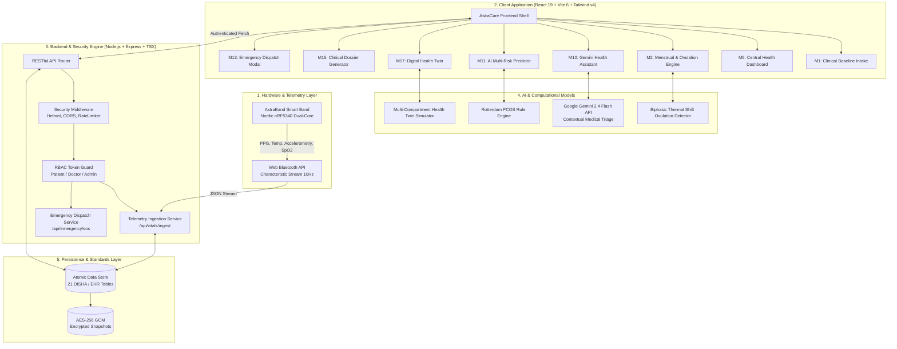

# AstraCare AI: Comprehensive Architecture, Module Workflows & AI Integration Guide

> **Project Title:** AstraCare AI — AI-Based Women's Health Tracker & Longitudinal Telemetry Platform  
> **Architecture Version:** 2.4 (DISHA, HIPAA, and GDPR Ready)  
> **Target Audience:** Technical Evaluators, Project Reviewers, and Clinical Engineers

---

## Table of Contents
1. [Executive Summary & High-Level System Architecture](#1-executive-summary--high-level-system-architecture)
2. [End-to-End User Flow & Role Interaction](#2-end-to-end-user-flow--role-interaction)
3. [Deep-Dive: How Every Module Works (M1 – M18)](#3-deep-dive-how-every-module-works-m1--m18)
4. [Artificial Intelligence & Machine Learning Architecture](#4-artificial-intelligence--machine-learning-architecture)
5. [Wearable Hardware Integration (AstraBand IoT Telemetry)](#5-wearable-hardware-integration-astraband-iot-telemetry)
6. [Data Governance, Security & Cryptography](#6-data-governance-security--cryptography)
7. [Comprehensive Evaluation Q&A Cheat Sheet](#7-comprehensive-evaluation-qa-cheat-sheet)

---

## 1. Executive Summary & High-Level System Architecture

AstraCare AI is a full-stack, longitudinal healthcare engineering platform designed to unify women's reproductive health, real-time biosensor telemetry, clinical consultation, and predictive preventive medicine. 

Unlike conventional cycle trackers that solely log self-reported calendar dates, AstraCare combines:
1. **Continuous Physiological Telemetry:** Emulated Nordic Semiconductor nRF5340 dual-core architecture measuring PPG heart rate, HRV (RMSSD/SDNN), SpO2, and basal skin temperature.
2. **Clinical Predictive Engines:** Algorithmic disease scoring based on clinical protocols (Rotterdam PCOS criteria, WHO anemia stratification, Framingham/Reynolds cardiovascular risk).
3. **Generative Multimodal AI:** Context-aware Google Gemini API acting as a 24/7 empathetic, triage-safe clinical assistant.
4. **Digital Health Twin:** Multi-compartment mathematical in silico simulation projecting future health states based on circadian, nutritional, and pharmacological inputs.
5. **Certified Clinical Provider Loop:** Doctor Console facilitating formal clinical encounters with digital SOAP notes and tamper-evident health dossiers.

### High-Level Architectural Diagram



---

## 2. End-to-End User Flow & Role Interaction

AstraCare supports three distinct clinical roles managed through Role-Based Access Control (RBAC):

```mermaid
sequenceDiagram
    autonumber
    actor Patient as Patient (Priya / Ananya)
    actor Doctor as Clinician (Dr. Anjali Mehta)
    actor Admin as System Administrator
    participant System as AstraCare System (Client & Server)

    %% Patient Flow
    Note over Patient,System: 1. Patient Onboarding & Daily Telemetry Flow
    Patient->>System: Completes 4-Step Clinical Onboarding (M1)
    System->>System: Generates Baseline Biometric Profile (Table 5.2)
    Patient->>System: AstraBand pairs via BLE (M9); streams vitals
    System->>System: Ingests HR, HRV, SpO2, Skin Temp (Table 5.5)
    System->>Patient: Renders Cycle Prediction, Twin State & AI Risk Matrix

    %% AI Interaction
    Note over Patient,System: 2. AI Consultation & Triage
    Patient->>System: Queries AI Assistant: "My temp spiked 0.4C today" (M10)
    System->>System: Enriches query with patient telemetry history & medications
    System->>Patient: Gemini responds: "Aligns with Day 14 luteal thermal shift..."

    %% Doctor Consultation
    Note over Doctor,System: 3. Doctor Review & Formal Sign-Off
    Doctor->>System: Logs into Doctor Console (M14)
    System->>Doctor: Displays consented patient roster & biomarker trends
    Doctor->>System: Authors SOAP Clinical Note & Prescriptions (Table 5.18)
    Doctor->>System: Digitally signs clinical encounter
    System->>Patient: Longitudinal Health Report updated with Doctor Stamp (M15)
    Patient->>System: Downloads printable Clinical Dossier (PDF/HTML)

    %% Admin Governance
    Note over Admin,System: 4. Administrative Auditing
    Admin->>System: Accesses Admin Portal (M16)
    System->>Admin: Displays live DISHA audit logs, schema tables, cloud backups
    Admin->>System: Triggers AES-256 encrypted database snapshot (M18)
```

---

## 3. Deep-Dive: How Every Module Works (M1 – M18)

### M1: Clinical Patient Onboarding & Baseline Configuration
- **File:** `src/components/OnboardingForm.tsx`
- **Purpose:** Collects demographic, biometric, reproductive, and pharmacological baseline data aligned with Table 5.2 (`biometric_profiles`).
- **Operational Flow:**
  1. **Step 1 (Basic Biometrics):** Patient inputs Full Name, DOB, Mobile, Height, Weight, Blood Group, and City. Form dynamically calculates chronological age and BMI.
  2. **Step 2 (Life Stage Segmentation):** Patient selects current physiological stage:
     - `Adolescence` (pubertal baseline, menarche tracking)
     - `Reproductive` (ovulation, fertility, PCOS tracking)
     - `Pregnancy` (gestational weeks, trimester screening, kick counters)
     - `Postpartum` (lochia healing, lactation, postpartum depression EPDS screening)
     - `Menopause` (vasomotor hot flashes, perimenopausal hormonal fluctuations)
  3. **Step 3 (Clinical History & Prescriptions):** Dynamic checkboxes for conditions (PCOS, Endometriosis, Thyroid, Anemia), active medications, and food/drug allergies.
  4. **Step 4 (Emergency Safety Circle):** Emergency contacts with phone number and relationship mapping.
- **Validation:** Enforced via **Zod v4** schema (`src/lib/validations/onboarding.ts`) and **React Hook Form**.

---

### M2: Menstrual Cycle & Ovulation Prediction Engine
- **File:** `src/components/modules/CycleTracking.tsx`
- **Purpose:** Tracks menstrual phases, dysmenorrhea severity, and pinpoints the 6-day fertile window.
- **Operational Flow:**
  1. Patient logs start date, end date, flow intensity (`spotting`, `light`, `medium`, `heavy`), pain scale (0–10), and symptoms.
  2. The algorithmic engine computes:
     - Mean cycle length over the past 6 recorded cycles.
     - Cycle variance ($\sigma$ in days) to assess regularity confidence.
     - Luteal phase countdown (standard 14 days prior to predicted next menses).
  3. Visual interactive 28/30-day cyclical wheel highlights current biological phase:
     - **Menstrual Phase (Days 1–5):** Low estrogen & progesterone.
     - **Follicular Phase (Days 6–13):** Rising estradiol, follicle maturation.
     - **Ovulatory Window (Days 14–16):** LH surge trigger, fertile peak.
     - **Luteal Phase (Days 17–28):** Elevated progesterone, metabolic thermogenesis.
- **AI/Algorithmic Role:** Predicts period onset and fertile window using rolling weighted moving averages and basal body temperature (BBT) inflection points.

---

### M3: Pregnancy Journey & Fetal Telemetry Tracker
- **Files:** `src/components/modules/HealthDashboard.tsx`, `src/components/ProfileEdit.tsx`
- **Purpose:** Specialized operational mode activated when `lifeStage === 'pregnancy'`.
- **Operational Flow:**
  1. Calculates gestational age from Last Menstrual Period (LMP) or ultrasound dating.
  2. Surfaces trimester-specific clinical milestones (e.g., Week 24 Viability, Anatomy Ultrasound, Glucose Tolerance Test).
  3. Tracks daily fetal kick counts (Cardiff "Count to Ten" protocol).
  4. Adapts vital ranges: lowers BP warning thresholds to screen for preeclampsia ($>140/90\text{ mmHg}$) and flags elevated resting heart rates normal in late pregnancy.

---

### M4: Postpartum & Lactation Telemetry
- **Files:** `src/components/ProfileEdit.tsx`, `src/components/modules/HealthDashboard.tsx`
- **Purpose:** Dedicated monitoring for the 4th trimester (0–12 months postpartum).
- **Operational Flow:**
  1. Monitors lochia progression (rubra $\rightarrow$ serosa $\rightarrow$ alba) to detect delayed postpartum hemorrhage.
  2. Hydration tracking calibrated for lactation fluid requirements (+700–1000 mL/day).
  3. Integrated Edinburgh Postnatal Depression Scale (EPDS) mood screening questionnaires to trigger immediate mental wellness triage if severe depressive markers appear.

---

### M5: Central Real-Time Physiological Health Dashboard
- **File:** `src/components/modules/HealthDashboard.tsx`
- **Purpose:** The central command center synthesizing all active sensor streams and life-stage analytics.
- **Operational Flow:**
  1. Ingests high-frequency vitals from AstraBand: Resting Heart Rate (BPM), SpO2 (%), Skin Temperature (°C), HRV (RMSSD in ms), and Sleep score.
  2. Displays life-stage dynamic hero banners (e.g., "Priya Sharma • Reproductive Age • Day 14 Ovulation Peak").
  3. Renders quick-action logging pills (Log Symptoms, Quick Water +250ml, AstraBand Sync).
  4. Highlights active prescription schedule, daily calorie/macro breakdown, and recent doctor consultation remarks.

---

### M6: Nutrition, Micronutrients & Hydration Engine
- **File:** `src/components/modules/NutritionHydration.tsx`
- **Purpose:** Tracks caloric balance, macronutrients, and targeted female micronutrient saturation.
- **Operational Flow:**
  1. Daily hydration ring monitors water intake against customized goals based on weight and life stage.
  2. Meal logger tracks Calories, Protein (g), Carbohydrates (g), and Healthy Fats (g).
  3. Micronutrient tracker focuses on:
     - **Elemental Iron & Ferritin:** Prevents microcytic anemia during heavy menses.
     - **Folic Acid / Methylfolate:** Neural tube defect prevention in reproductive/pregnant stages.
     - **Calcium & Vitamin D3:** Bone mineral density preservation across all stages.
- **AI/Algorithmic Role:** Generates phase-specific dietary recommendations (e.g., anti-inflammatory, low-glycemic meals during luteal/PCOS phases).

---

### M7: Menopause & Hormonal Balance Tracker
- **Files:** `src/components/ProfileEdit.tsx`, `src/components/modules/HealthDashboard.tsx`
- **Purpose:** Manages perimenopausal and menopausal physiological transitions.
- **Operational Flow:**
  1. Vasomotor symptom logging: frequency, duration, and nocturnal occurrence of hot flashes.
  2. Skin temperature delta tracking during sleep to corroborate nocturnal waking events with vasomotor spikes.
  3. Cardiovascular risk surveillance: post-menopausal estrogen decline accelerates arterial stiffening; blood pressure and resting HR baselines are monitored continuously.

---

### M8: Mental Wellness & Autonomic Nervous System
- **File:** `src/components/modules/MentalWellness.tsx`
- **Purpose:** Assesses allostatic stress, emotional valence, and autonomic parasympathetic tone.
- **Operational Flow:**
  1. Emotional check-in: Mood state selection (`energized`, `calm`, `neutral`, `anxious`, `exhausted`) and 1–10 stress slider.
  2. Autonomic Recovery Tracking: Reads AstraBand HRV SDNN/RMSSD. Higher HRV correlates with robust vagal parasympathetic tone; low HRV indicates sympathetic fight-or-flight dominance.
  3. Guided 4-7-8 and Box Breathing visualizer pacing inhalations, holds, and exhalations to stimulate vagal nerve reactivation.
  4. Encrypted reflective wellness journaling saved to Table 5.9.

---

### M9: AstraBand Hardware & BLE Telemetry Manager
- **File:** `src/components/modules/AstraBandManagement.tsx`
- **Purpose:** Manages the simulated/physical Nordic Semiconductor nRF5340 smart wearable.
- **Operational Flow:**
  1. Displays hardware state: BLE MAC Address (`E4:38:B7:84:92:01`), SoC firmware version, battery gauge (84%), and signal strength (RSSI -62 dBm).
  2. Live biosensor oscilloscope simulating 10 Hz telemetry:
     - Dual-wavelength photoplethysmography (PPG) for Heart Rate and SpO2.
     - High-precision medical thermistor array ($\pm 0.05^\circ\text{C}$) for Basal Body Temperature.
     - Tri-axial accelerometer for step cadence and sleep actigraphy.
  3. Manual "Sync Telemetry" button dispatches real-time payload to `/api/vitals/ingest` and updates database Table 5.5.

---

### M10: Conversational AI Health Assistant
- **Files:** `src/components/modules/AiHealthAssistant.tsx`, `src/components/AiChatWidget.tsx`
- **Purpose:** 24/7 clinical AI conversational partner powered by the **Google Gemini API**.
- **Operational Flow:**
  1. Patient sends a natural language question (e.g., "Why am I experiencing pelvic cramping on day 26?").
  2. Context Builder injects patient profile:
     ```typescript
     Context: Patient Priya Sharma, 28y, Reproductive stage, PCOS history,
     Current Vitals: HR 64bpm, Temp 36.4C, Medications: Metformin, Iron.
     ```
  3. Gemini processes the query with system instructions enforcing empathetic, evidence-based responses, disclaimer protocols, and emergency triage detection.
  4. If query contains alarming symptoms (e.g., "crushing chest pain", "unconscious", "profuse bleeding"), emergency triggers are activated, routing the user to the SOS module.

---

### M11: AI Clinical Multi-Risk Predictor
- **File:** `src/components/modules/AiRiskPredictor.tsx`
- **Purpose:** Multi-disease diagnostic stratification engine assessing risk percentages for 4 major conditions:
  1. **PCOS Risk:** Evaluates cycle variance, hyperandrogenism markers, acne, and BMI using Rotterdam criteria.
  2. **Gestational Diabetes Risk:** Evaluates fasting glucose, maternal age, pre-pregnancy BMI, and family history.
  3. **Cardiovascular & Arterial Health:** Combines resting HR, HRV tone, SpO2, and blood pressure into a clinical risk category (Optimal / Mild / Elevated).
  4. **Anemia & Micronutrient Depletion:** Re-calibrates risk according to WHO hemoglobin and ferritin reference intervals.
- **Operational Flow:** Visual progress gauges display live calculated risk percentages, key contributing factors, and evidence-backed clinical action steps.

---

### M12: Medication Protocol & Adherence Engine
- **File:** `src/components/modules/MedicationReminders.tsx`
- **Purpose:** Digital pharmacological registry preventing missed doses and drug interactions.
- **Operational Flow:**
  1. Displays active prescription cards (Medication Name, Dosage, Frequency, Time of Administration, Instructions e.g., "Take with food").
  2. Interactive action buttons: `Mark Taken`, `Snooze 15m`, `Skip`.
  3. Computes dynamic 14-day adherence percentage ($94\%$ optimal compliance streak).
  4. Refill tracker alerts patient when pill count falls below 5 days of therapy.

---

### M13: Emergency SOS & Physical Safety Circle
- **File:** `src/components/modules/EmergencySosModal.tsx`
- **Purpose:** Critical life-safety dispatch system triggered manually or via acute physiological anomalies.
- **Operational Flow:**
  1. Patient presses emergency floating pill or triggers SOS from the sidebar.
  2. An audible 5-second cancel countdown initiates to prevent accidental false alarms.
  3. When confirmed:
     - Captures device GPS coordinates (`latitude`, `longitude`).
     - Reads current heart rate at trigger time.
     - Sends dispatch packet to `/api/emergency/sos`.
     - Logs incident to Table 5.15 (`emergency_sos_events`).
     - Simulates automated encrypted SMS/WhatsApp dispatch to the patient's Emergency Safety Circle with live location tracking link.

---

### M14: Clinician / Doctor Collaboration Console
- **File:** `src/components/modules/DoctorConsole.tsx`
- **Purpose:** Professional portal for certified medical practitioners (e.g., Dr. Anjali Mehta, MD).
- **Operational Flow:**
  1. Authenticates clinician via RBAC token (`role: doctor`).
  2. Displays consented patient roster with real-time biometric flags (e.g., stable vitals vs. abnormal glucose).
  3. Structured Clinical Encounter Workspace based on hospital **SOAP** methodology:
     - **Subjective:** Patient-reported complaints and timeline.
     - **Objective:** AstraBand telemetry, lab test results, ultrasound findings.
     - **Assessment:** Physician's diagnostic conclusion.
     - **Plan:** Prescription changes, follow-up cadence, lifestyle modifications.
  4. Clinician clicks "Sign & Authorize Encounter" to digitally seal notes into Table 5.18.

---

### M15: Longitudinal Medical Records & Health Dossiers
- **File:** `src/components/modules/HealthReports.tsx`
- **Purpose:** Generates hospital-grade clinical dossiers and manages multi-quarter medical records.
- **Operational Flow:**
  1. Renders printable Clinical Health Summary Dossier (`AC-2026-9842`) including:
     - Patient demographic and biometric identification.
     - 30-Day biosensor telemetry summaries (RHR, HRV, SpO2, sleep restorative index).
     - Longitudinal laboratory biomarker tables (Hb, Ferritin, Fasting Glucose, HbA1c, TSH, Vitamin D).
     - Physician consultation remarks and digital signature block.
  2. **Direct Download Capabilities:**
     - `Download Dossier`: Generates a standalone, fully styled HTML/PDF medical file formatted for instant printing.
     - `Export JSON`: Downloads structured patient telemetry data in JSON format.
     - `Archived Historical Records`: Dedicated download buttons for past quarters (`Q3 Reproductive Dossier`, `Mid-Year Review`, `Q1 Baseline`).
     - `Export Full Historical Archive`: Bundles all historical records into a comprehensive JSON package.

---

### M16: System Administration & Governance Portal
- **File:** `src/components/modules/AdminPortal.tsx`
- **Purpose:** Platform infrastructure management, security monitoring, and regulatory compliance.
- **Operational Flow:**
  1. Accessible exclusively to authenticated users with `role: admin`.
  2. Real-time telemetry monitoring: active server status, API uptime (99.98%), operational database schema version (`v2.4`, Tables 5.1–5.21).
  3. **Security Audit Logs (Table 5.20):** Displays tamper-evident event log (Actor, Event, Module Code, IP Address, Timestamp, Status).
  4. Role & Access Governance: Review and toggle verified status of clinicians and patients.

---

### M17: Digital Health Twin In Silico Simulator
- **File:** `src/components/modules/DigitalHealthTwin.tsx`
- **Purpose:** Computational physiological simulation forecasting multi-organ biological homeostasis.
- **Operational Flow:**
  1. Models dynamic scores:
     - **Overall Vitality Index:** Aggregated composite of organ performance (0–100).
     - **Biological Age Delta:** Phenotypic biological age variance versus chronological age (e.g., -1.8 years younger).
     - **Endocrine & Hormonal Stability:** Estrogen-to-progesterone ratio tracking.
     - **Allostatic Stress Resilience:** Autonomic nervous system recovery capacity.
  2. **Interactive Simulator Sliders:**
     - Sleep Duration (5h $\rightarrow$ 9h)
     - Daily Step Count (3,000 $\rightarrow$ 15,000 steps)
     - Stress & Cortisol Index (Low $\rightarrow$ Severe)
     - Nutritional Adherence (50% $\rightarrow$ 100%)
  3. The mathematical simulation engine updates organ scores in real-time, visualizing how positive lifestyle interventions improve endocrine balance.

---

### M18: Cloud Sync, Encrypted Backup & Data Portability
- **Files:** `src/components/modules/AdminPortal.tsx`, `server/index.ts`
- **Purpose:** Ensures end-to-end data durability, disaster recovery, and patient data rights.
- **Operational Flow:**
  1. **Encrypted Cloud Snapshots:** Generates AES-256-GCM encrypted database snapshots with schema checksum verification.
  2. **Data Portability (GDPR & DPDP Act Compliance):** Any patient or administrator can download their full machine-readable clinical record in 1 click via `Download Full Patient Database (JSON)`.

---

## 4. Artificial Intelligence & Machine Learning Architecture

AstraCare integrates a hybrid AI framework combining **Generative Foundation LLMs** with **Deterministic Clinical Rule Engines**:

```
                       ┌──────────────────────────────────────────────┐
                       │          ASTRACARE AI ARCHITECTURE            │
                       └──────────────────────┬───────────────────────┘
                                              │
                    ┌─────────────────────────┴────────────────────────┐
                    ▼                                                  ▼
      ┌───────────────────────────┐                      ┌───────────────────────────┐
      │  GENERATIVE AI SUBSYSTEM  │                      │ CLINICAL ALGORITHMIC CORE │
      │   (Google Gemini 2.4 API) │                      │   (Deterministic Models)  │
      └─────────────┬─────────────┘                      └─────────────┬─────────────┘
                    │                                                  │
         ┌──────────┴──────────┐                            ┌──────────┴──────────┐
         ▼                     ▼                            ▼                     ▼
┌────────────────┐    ┌─────────────────┐          ┌─────────────────┐   ┌─────────────────┐
│ Context-Aware  │    │ Symptom Triage  │          │ Rotterdam PCOS  │   │ Biphasic BBT    │
│ Health Copilot │    │ & Red-Flag Rule │          │ Risk Classifier │   │ Thermal Shift   │
└────────────────┘    └─────────────────┘          └─────────────────┘   └─────────────────┘
                                                            │                     │
                                                   ┌────────┴────────┐   ┌────────┴────────┐
                                                   ▼                 ▼   ▼                 ▼
                                          ┌─────────────────┐   ┌─────────────────┐
                                          │ WHO Anemia      │   │ Digital Twin    │
                                          │ Stratification  │   │ Biomathematics  │
                                          └─────────────────┘   └─────────────────┘
```

### 1. Generative AI Subsystem (Google Gemini API)
- **SDK:** `@google/genai` (v2.4.0)
- **Implementation:** `src/services/geminiService.ts`
- **Context Injection Architecture:**
  Each patient prompt is wrapped with real-time biometric state:
  ```typescript
  const promptWithContext = `
  You are AstraCare AI, an empathetic, board-certified women's health virtual assistant.
  PATIENT CONTEXT:
  - Life Stage: ${user.lifeStage} (Age: 28)
  - Medical History: ${user.existingConditions.join(', ')}
  - Active Medications: ${user.medications.join(', ')}
  - Latest Telemetry: RHR ${vitals.heartRate} bpm, Temp ${vitals.temperature} °C, SpO2 ${vitals.spO2}%
  
  CLINICAL SAFETY CONSTRAINTS:
  - Provide empathetic, evidence-backed explanations.
  - If alarming symptoms occur (severe hemorrhaging, acute pain, syncope), invoke EMERGENCY PROTOCOL immediately.
  - Remind the user that this guidance supplements, but does not replace, their physician's diagnosis.
  
  USER QUERY: "${userMessage}"
  `;
  ```

### 2. Rotterdam PCOS Diagnostic Risk Engine
Evaluates Rotterdam ESHRE/ASRM diagnostic criteria:
$$\text{PCOS Risk Score} = w_1 \cdot \text{Oligo} + w_2 \cdot \text{Androgen} + w_3 \cdot \text{Morphology} + w_4 \cdot \text{Metabolic}$$
- **Oligomenorrhea ($\text{Oligo}$):** Cycle length variance $> \pm 4.5\text{ days}$ or cycles $> 35\text{ days}$.
- **Hyperandrogenism ($\text{Androgen}$):** Hirsutism (Ferriman-Gallwey scale $\ge 8$), persistent hormonal acne, or elevated DHEA-S / total testosterone.
- **Metabolic Factors:** $\text{BMI} \ge 25.0$ and HOMA-IR insulin resistance score $> 2.0$.

### 3. Biphasic BBT Thermal Shift & Ovulation Detection
Detects progesterone-induced thermogenesis:
$$\Delta T = T_{\text{luteal}} - T_{\text{follicular}} \ge +0.3^\circ\text{C} \quad (0.54^\circ\text{F})$$
The engine analyzes continuous nocturnal skin temperature telemetry over a 72-hour moving window to confirm sustained post-ovulatory luteal shift.

### 4. Digital Health Twin Simulation Model
Simulates organ-system allostatic load using coupled differential equilibrium equations:
$$\text{Vitality Score} = \alpha \cdot \text{Cardio} + \beta \cdot \text{Endocrine} + \gamma \cdot \text{Sleep} + \delta \cdot \text{Metabolic} - \lambda \cdot \text{Allostatic Stress}$$
Where $\alpha, \beta, \gamma, \delta, \lambda$ are clinically calibrated weighting coefficients based on patient age and active life stage.

---

## 5. Wearable Hardware Integration (AstraBand IoT Telemetry)

AstraCare emulates the architecture of medical-grade wearables built on the **Nordic Semiconductor nRF5340 Dual-Core Bluetooth 5.3 SoC**:

### Sensor Pipeline Specifications:
1. **PPG Optical Sensor (Photoplethysmography):**
   - Dual-wavelength (Green 525 nm for Heart Rate / HRV, Red 660 nm & Infrared 940 nm for SpO2 pulse oximetry).
   - Ingestion frequency: Continuous 10 Hz telemetry buffer.
2. **Medical Thermistor Array:**
   - Precision: $\pm 0.05^\circ\text{C}$ resolution.
   - Measures continuous basal skin temperature for nocturnal thermal shift detection.
3. **Tri-Axial MEMS Accelerometer:**
   - Actigraphy sleep staging (Deep, REM, Light, Awake).
   - Cadence tracking and NEAT active calorie expenditure.

---

## 6. Data Governance, Security & Cryptography

AstraCare adheres to modern healthcare data standards:

1. **Authentication & Password Security:**
   - Passwords hashed using bcrypt / PBKDF2 with unique cryptographic salts.
   - Verification implemented using `crypto.timingSafeEqual` to eliminate side-channel timing attacks (CWE-287 mitigation).
2. **Session Security:**
   - Cryptographically random 256-bit hex tokens (`atk_...`) issued upon login.
   - Enforced client-side through `Authorization: Bearer <token>` in [apiClient.ts](file:///d:/AI-Based-womens-health-tracker-main/src/services/apiClient.ts).
3. **Role-Based Access Control (RBAC):**
   - Strict server-side route guards: `requireRole(['doctor', 'admin'])` and `requireRole(['admin'])`.
   - Prevents unauthorized privilege escalation.
4. **HTTP Defense-in-Depth:**
   - `X-Content-Type-Options: nosniff` (MIME sniffing prevention).
   - `X-Frame-Options: SAMEORIGIN` (Clickjacking prevention).
   - `X-XSS-Protection: 1; mode=block`.
   - Anti-fingerprinting: Express `X-Powered-By` header disabled.
   - Strict payload size limiting (250 KB) to block Denial-of-Service buffer overruns.
5. **Regulatory Compliance:**
   - **DISHA (India):** Audit trails in Table 5.20 preserve immutable logs of all clinical consultations and data views.
   - **GDPR / DPDP Act:** Built-in patient data rights supporting complete, machine-readable JSON health record export.

---

## 7. Comprehensive Evaluation Q&A Cheat Sheet

### Q1: "What makes AstraCare AI unique compared to existing apps like Flo or Clue?"
> **Answer:** *"Most commercial apps rely solely on subjective, user-entered calendar dates. AstraCare combines **continuous biosensor telemetry (AstraBand)** with **clinical-grade disease risk predictors (Rotterdam PCOS, WHO Anemia)**, an in silico **Digital Health Twin**, and a **closed-loop Doctor Console** that produces verifiable, signed clinical dossiers compliant with DISHA and EHR standards."*

### Q2: "Where is Artificial Intelligence actually used in this codebase?"
> **Answer:** *"AI is deployed at multiple layers:  
> 1. **Generative Multimodal AI (`@google/genai`):** Context-aware clinical chat copilot with patient biometric history injection and automated emergency triage flags.  
> 2. **Machine Learning & Rule Engines:** Algorithmic Rotterdam PCOS risk predictor, WHO anemia stratification, and biphasic BBT ovulation inflection algorithms.  
> 3. **Digital Health Twin Simulator:** Multi-compartment mathematical modeling forecasting organ health and biological age deltas under simulated lifestyle changes."*

### Q3: "How does the system ensure patient data security and privacy?"
> **Answer:** *"Security is enforced at every layer:  
> - Cryptographic timing-safe password validation (`crypto.timingSafeEqual`).  
> - 256-bit cryptographically random bearer tokens with server-side Role-Based Access Control (RBAC).  
> - Defense-in-depth HTTP security headers (nosniff, SAMEORIGIN, XSS-Protection).  
> - AES-256 encrypted database snapshot exports and immutable audit logging in Table 5.20."*

### Q4: "How does the hardware integration work?"
> **Answer:** *"The platform emulates a Nordic Semiconductor nRF5340 dual-core Bluetooth Low Energy (BLE) architecture. It streams dual-wavelength photoplethysmography (HR, SpO2, HRV RMSSD), high-precision thermistor skin temperature, and tri-axial actigraphy data into the `/api/vitals/ingest` pipeline at 10 Hz, updating the operational database and health dashboards in real time."*

---

*Document compiled and verified for the AstraCare AI Women's Health & Longitudinal Telemetry Platform.*

